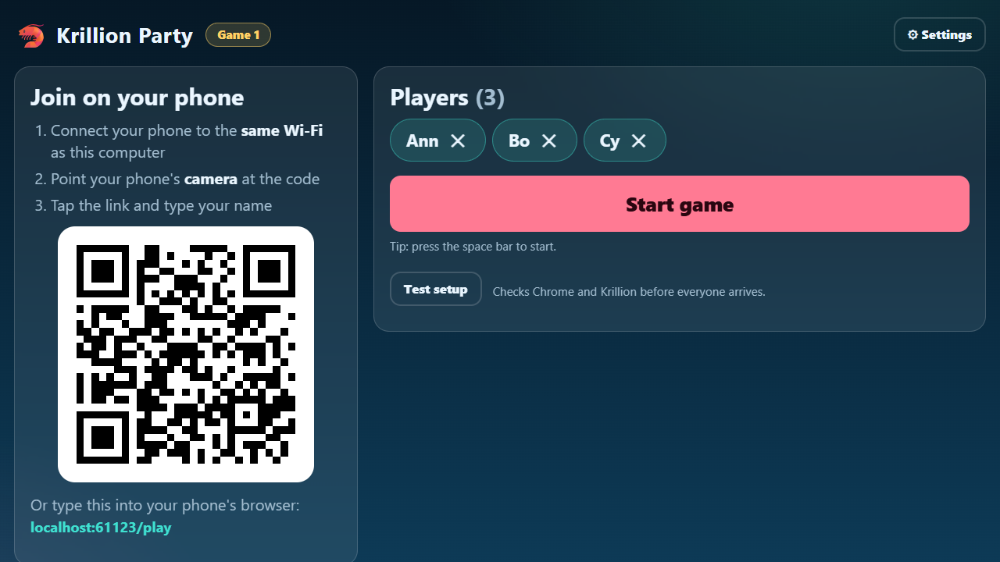
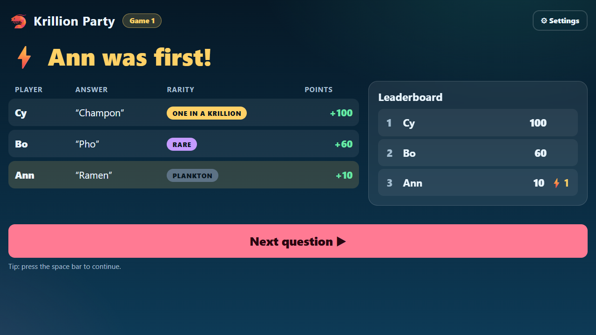
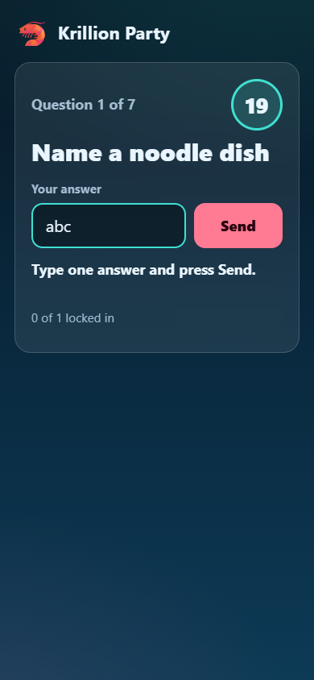
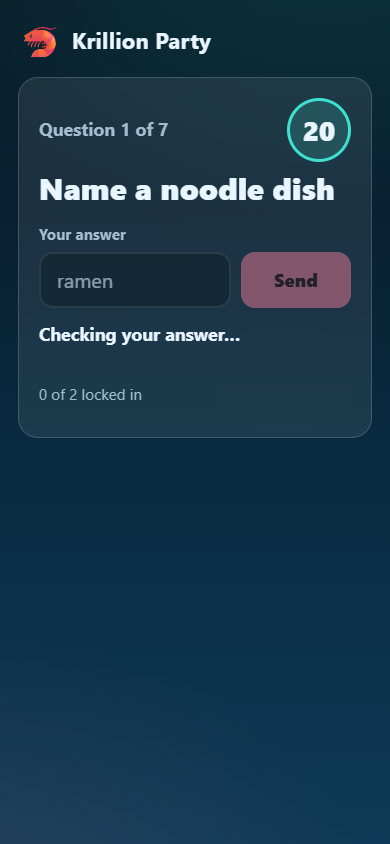
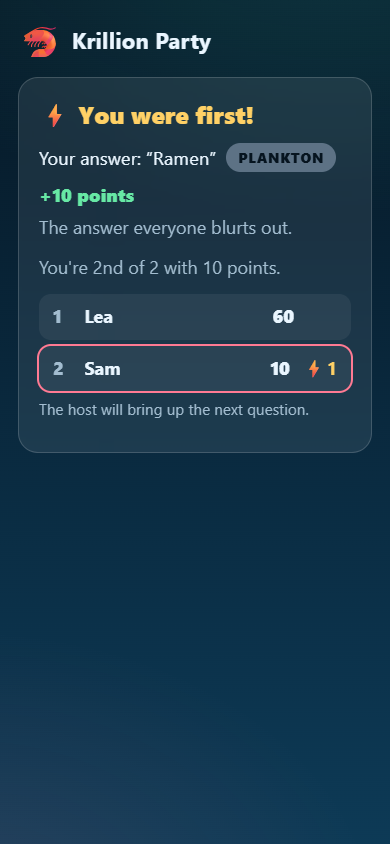
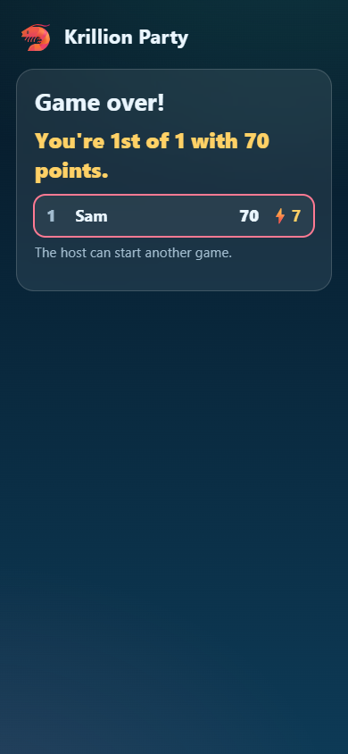

# 🦐 Krillion Party

**Play [Krillion](https://krillion.io) with the whole family at once.** Everyone scans a QR code, types answers on their own phone at the same time, and the first one to land an answer wins the round. Put the host screen on the TV and go.

<p>
  
  
</p>
<p>
  
  
  
  
</p>

> **Unofficial.** Krillion Party is a fan-made helper and is not affiliated with Krillion or its creator. It plays the normal website in a browser window, the same way a person would. If you enjoy the game, please support it at [krillion.io](https://krillion.io).

## What you need

- A **Mac or Windows PC** to be the host (the one plugged into the TV)
- **[Google Chrome](https://www.google.com/chrome/)** on that computer
- **[Node.js](https://nodejs.org/en/download)** on that computer (free; pick the "LTS" installer and click through it)
- Everyone on the **same Wi-Fi**

## Start in 3 steps

### 1. Get it
On this page click the green **Code** button, then **Download ZIP**, and unzip it. (Or `git clone` it, if you know how.)

### 2. Start it
- **Windows:** double-click **`Start Krillion Party.bat`**.
- **Mac:** double-click **`Start Krillion Party.command`**. If your Mac refuses to open it, use this instead, which needs no ZIP and no permissions. Open *Terminal* (press ⌘+Space, type "Terminal", press Enter), paste this one line and press Enter:
  ```
  cd ~/Downloads && curl -fsSL https://github.com/MalekBaghdadi/krillion-party/archive/refs/heads/main.tar.gz | tar xz && cd krillion-party-main && bash "Start Krillion Party.command"
  ```
- Already comfortable with Node and git? `npx github:MalekBaghdadi/krillion-party` works too.

The first start sets itself up (about a minute). Then the host screen opens in your browser.

### 3. Play
1. Put the host screen on the TV (just show that browser window).
2. Everyone scans the **QR code** with their phone camera and types their name.
3. Press **Start game** (or the space bar).

Each question, everyone types an answer. The host presses **Next question** (or space) after the reveal.

## How a game works

- Everyone gets **the same 7 questions** at the same time, each with a countdown.
- **⚡ The race:** the first player whose answer Krillion accepts wins the question.
- **Points:** each player is also scored by Krillion itself. Rarer answers are worth more (a very common answer is worth 10, the rarest up to 100). The leaderboard shows both points and ⚡ wins.
- A wrong or unknown answer doesn't use up your turn: try again (up to 5 tries per question).
- Typos are forgiven the way Krillion forgives them: if your answer is a little off, Krillion suggests its closest answer ("Did you mean Ramen?"). The box fills in with the suggestion, and you tap **Send** again to confirm it, or change it. A suggestion doesn't count as a try.
- Behind the scenes the host computer opens one hidden Krillion window per player, so everyone really plays their own game.

## Playing other Krillion games

Krillion's "Unlimited" mode has numbered games, and everyone on the same number gets the same questions. **Game 1 is free.** For other numbers you need Krillion's one-time unlock (about $5, from krillion.io):

1. On the host screen click **⚙ Settings**.
2. Type the **game number** you want.
3. Paste your **Krillion unlock link** (it looks like `https://krillion.io/unlock?session_id=...`; it is the address you were sent to right after you paid, so check your browser history or payment email).
4. Click **Save**, then **Test setup** to check it works.

Your link is kept only on this computer (in a private folder called `.krillion-party` in your home folder) and is only ever sent to krillion.io. It is never shown on screen again.

## Before everyone arrives: "Test setup"

On the host screen click **Test setup**. It opens two throwaway windows, checks Chrome and Krillion work, and tells you in plain words if something is wrong.

## Something not working?

| What happens | What to do |
|---|---|
| A phone can't open the page | Make sure it is on the **same Wi-Fi** as the computer (not mobile data, not a separate "guest" network). If there are several addresses under the QR code, try another one. If your computer asks to allow incoming connections, choose **Allow**. |
| "Chrome was not found" | Install [Google Chrome](https://www.google.com/chrome/) and start again. |
| "Game N is locked" | Add your unlock link in **Settings**, or use game 1. |
| Windows says "Windows protected your PC" | Click **More info**, then **Run anyway**. (The launcher is a plain text file that isn't code-signed.) |
| Mac says the file "cannot be opened" | Right-click the file, choose **Open**, then **Open**. On macOS 15 or newer there may be no Open button: open **System Settings > Privacy & Security**, scroll down and click **Open Anyway**. Or just use the Terminal line above, which avoids this. |
| Mac says "permission denied" | Use the Terminal line above. Downloading a ZIP can drop the permission that lets the launcher run. |
| "Node.js is too old" | Krillion Party needs Node.js 20 or newer. Install the current LTS from [nodejs.org](https://nodejs.org/en/download). |
| It says setup files are missing | An earlier setup was interrupted. Delete the folder named `node_modules` inside the Krillion Party folder and start again. |
| The game acts strangely | Close the black window, start again. Run **Test setup**. |
| Krillion changed and nothing works | Krillion Party reads Krillion's web page, so a big redesign can break it. See "For developers" below. |

## For developers

```
npm install
npm test        # offline: a fake Krillion server stands in for the real site (needs Chrome or Edge installed)
npm run smoke   # one live check against the real krillion.io
npm start
```

- `src/game.js` is the pure rules (players, attempts, race winner). `src/krillion.js` drives one Krillion session; `src/pool.js` runs one per player; `src/party.js` ties them together; `src/server.js` serves the pages and API.
- Everything the code assumes about krillion.io is listed in [`docs/krillion-dom.md`](docs/krillion-dom.md). If Krillion changes, `npm run smoke` shows what broke and that file says where to fix it.
- Design notes and the implementation plan are in `docs/superpowers/`.
- Status: developed and tested on Windows with Chrome. The macOS launcher is written but not yet tested on a real Mac. Reports and fixes are welcome.

## License

MIT. See [LICENSE](LICENSE).
